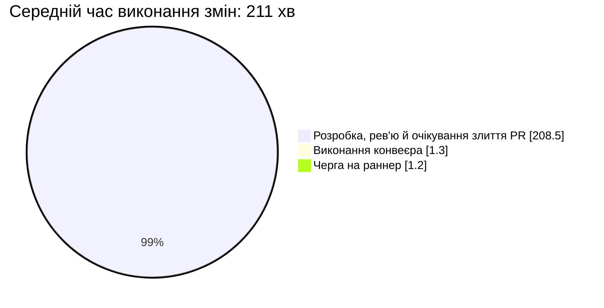
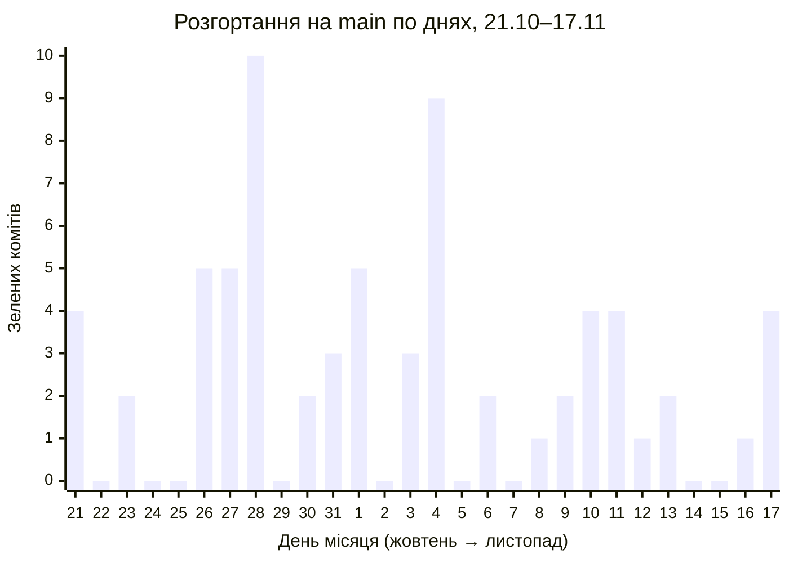

# Звіт DORA (Лабораторна 10; зріз 17.11.2026)

За 3,84 тижня (21.10 20:36–17.11 16:23, Europe/Kyiv) команда злила в `main` 71 зміну; 69 пройшли конвеєр повністю. Медіанна зміна потрапляє в `main` і проходить CI за пів години від першого коміту, а з двох збоїв конвеєр повертався до зеленого стану в середньому за годину.

**Це наближення.** DORA вимірює розгортання в робоче середовище, а тут джерело — історія GitHub Actions на `main`. Зелений коміт на `main` вважається розгортанням: API на Render розгортається з `main`, а workflow `Generate and Deploy API Docs` публікує документацію на GitHub Pages. Сирі дані — [`metrics-raw.md`](./metrics-raw.md) (останні 90 запусків), розрахунок — `scripts/compute_dora.py`.

## Як рахували

- **Розгортання** — зелений коміт на `main`. Враховано workflow, що запускаються на `main`: `CI` і `Generate and Deploy API Docs`. `Verify OpenAPI` запускається лише на pull request і в розрахунок не входить.
- **Одиниця — коміт на `main`, а не запуск.** Кожне злиття запускає до двох workflow (`CI` і `Generate and Deploy API Docs`). Підрахунок запусків подвоїв би частоту розгортань і викривив би частку збоїв. Тому 90 запусків згруповано в 71 коміт.
- **Зелений коміт** — усі його завершені запуски успішні. **Червоний** — упав хоча б один.
- **Скасований запуск** (1 випадок, `fe3ea01`) не вважається збоєм зміни: інший запуск того самого коміту пройшов успішно.
- **Час виконання змін** — від першого коміту PR до завершення останнього успішного запуску цього коміту на `main`.
- **Відновлення** — від завершення червоного запуску до завершення наступного повністю зеленого коміту.

## Метрики DORA

| Метрика | Формула | Результат | Категорія (DORA 2025: рівень → частка опитаних із таким або кращим результатом) |
|---|---|---|---|
| Частота розгортань | зелені коміти на `main` / тижні | 69 / 3,84 тиж. = **18,0 на тиждень** (≈ 2,6 на день); медіана інтервалу між розгортаннями — 1,7 год | **від щогодини до щодня → 22,7%** |
| Час виконання змін | середнє й медіана від першого коміту PR до зеленого запуску на `main` | **середнє 3,5 год, медіана 0,5 год** (69 змін) | **менше години → 9,4%** (за медіаною; за середнім — «менше доби», 24,4%) |
| Частота збоїв змін | червоні коміти / усі завершені коміти × 100% | 2 / 71 = **2,8%** | **2–4% → 16,7%** |
| Час відновлення | середнє й медіана від червоного запуску до наступного зеленого | **8 хв і 111 хв; середнє й медіана 59,5 хв** | **менше години → 21,3%** |

**Частота розгортань.** Середнє (≈ 2,6 на день) формально відповідає й рівню «на вимогу», але розгортання бувають не щодня: між сесіями роботи команди є дні без злиттів. Тому рівень визначено за медіанним інтервалом між розгортаннями (1,7 год), який лежить між годиною і добою.

**Час виконання змін.** Розподіл сильно скошений: більшість PR зливаються протягом години, але кілька висіли до наступного дня (наприклад, #255 — 12 год, з ночі до полудня). Через це середнє приблизно в сім разів більше за медіану.

**Частота збоїв і відновлення — на дуже малій вибірці.** Два випадки:

| Коміт | PR | Що впало | Причина | Відновлення |
|---|---|---|---|---|
| `d7f155f` | [#206](https://github.com/ukma-fin-ssdm-2026/noproblem/pull/206) | `Generate and Deploy API Docs`, крок `Fail if committed spec is stale` | Закомічена OpenAPI-специфікація не збіглася зі згенерованою з коду — справжня помилка зміни | 8 хв |
| `d2a8a79` | [#255](https://github.com/ukma-fin-ssdm-2026/noproblem/pull/255) | `Generate and Deploy API Docs`, крок `Setup Python` | HTTP 504 під час завантаження Python 3.12 на self-hosted раннер — інфраструктурний збій, не помилка коду | 111 хв |

Якщо не рахувати інфраструктурний збій, частота збоїв змін — 1 / 71 = 1,4% (рівень «0–2%»), а відновлення — 8 хв. Ми лишаємо обидва випадки, як вимагає формула, але для DORA, де йдеться про збої через зміни, точніше нижнє значення.

### Blameless postmortem

#### Порядок фіксації

Для кожного червоного коміту на `main` додайте короткий запис до таблиці postmortem:

1. Вкажіть коміт і PR, посилання на невдалий GitHub Actions run, workflow та крок, що завершився помилкою.
2. Окремо зафіксуйте **технічну причину й вплив** (тільки те, що підтверджують логи) та **процесний чинник** (умови в перевірках або процесі, що дозволили збою дійти до `main`). Якщо першопричину не встановлено, прямо це зазначте.
3. Додайте посилання на наступний повністю зелений коміт на `main` і його Actions run, час відновлення та підтверджений спосіб виправлення. Не приписуйте причинний зв'язок, якщо його не підтверджують дані.
4. Опишіть висновки й подальші дії без персональних звинувачень; для кожної дії вкажіть відповідального.

У цьому звіті посилання в рядках нижче ведуть до відповідних Actions runs та комітів, що відновили зелений стан.

| Інцидент | Вплив і технічна причина | Процесний чинник / першопричина | Відновлення та межі доказів |
|---|---|---|---|
| [PR #206, `d7f155f`](https://github.com/ukma-fin-ssdm-2026/noproblem/pull/206) · [невдалий Actions run](https://github.com/ukma-fin-ssdm-2026/noproblem/actions/runs/40733267792) | Workflow `Generate and Deploy API Docs` зупинився на `Fail if committed spec is stale`: закомічена OpenAPI-специфікація відрізнялася від згенерованої з коду. Workflow `CI` для того самого SHA пройшов. | Перевірка відповідності специфікації була налаштована на `push` у `main`, а не на `pull_request` ([`deploy-api-docs.yml`](../../.github/workflows/deploy-api-docs.yml)). Тому застаріла специфікація була виявлена вже після злиття. Це прогалина в моменті перевірки, а не помилка окремої людини. | Наступний повністю зелений коміт — [PR #207](https://github.com/ukma-fin-ssdm-2026/noproblem/pull/207), [`74e8487`](https://github.com/ukma-fin-ssdm-2026/noproblem/commit/74e84874ceb46fc063c1305a4287063e583ad7c4), [успішний Actions run](https://github.com/ukma-fin-ssdm-2026/noproblem/actions/runs/40734430052), через 8 хв. Наявні дані не вказують, якою саме зміною була усунута розбіжність; не приписуємо конкретне виправлення без журналу. |
| [PR #255, `d2a8a79`](https://github.com/ukma-fin-ssdm-2026/noproblem/pull/255) · [невдалий Actions run](https://github.com/ukma-fin-ssdm-2026/noproblem/actions/runs/42469775493) | `Setup Python` завершився помилкою HTTP 504 під час завантаження Python 3.12 на self-hosted runner. `CI` для того самого SHA пройшов, але запуск API Docs — ні; за прийнятим визначенням коміт не був повністю зеленим. | Зафіксована причина — інфраструктурна, а не помилка коду. У наявних даних немає підстав визначити глибшу причину HTTP 504 або організаційний чинник; персональну причину не встановлюємо. | Наступний повністю зелений коміт — [PR #256](https://github.com/ukma-fin-ssdm-2026/noproblem/pull/256), [`9e6bd9c`](https://github.com/ukma-fin-ssdm-2026/noproblem/commit/9e6bd9c5349b22b5b0849e1b27671557a0bcab01), [успішний Actions run](https://github.com/ukma-fin-ssdm-2026/noproblem/actions/runs/42477782958), через 111 хв. Конкретний крок, що усунув збій завантаження, у наявних доказах не встановлений. |

### Оновлений зріз та ефект перевірки OpenAPI

Новий зріз охоплює останні 90 запусків `main` від 21.10 20:36 до 17.11 16:23 (Europe/Kyiv): 71 коміт, 69 зелених і 2 червоні. Після попереднього зрізу (останній запуск — [CI для PR #271](https://github.com/ukma-fin-ssdm-2026/noproblem/actions/runs/43395272181)) до 17.11 відбулося ще 9 запусків для 7 комітів; усі успішні. Останній CI-запуск — [merge-коміт PR #278](https://github.com/ukma-fin-ssdm-2026/noproblem/actions/runs/44102588117), останній запуск API Docs — [PR #276](https://github.com/ukma-fin-ssdm-2026/noproblem/actions/runs/44091467330).

**До зміни:** на PR #206 застаріла специфікація впала вже після злиття на `main`. **Після зміни:** [PR #278](https://github.com/ukma-fin-ssdm-2026/noproblem/pull/278) злито; його [перевірка Verify OpenAPI](https://github.com/ukma-fin-ssdm-2026/noproblem/actions/runs/44102098483) успішно згенерувала специфікацію та пройшла крок `Fail if committed spec is stale`. Усі перевірки PR пройшли, після злиття [CI на `main`](https://github.com/ukma-fin-ssdm-2026/noproblem/actions/runs/44102588117) також успішний. Це підтверджує, що актуальна специфікація проходить перевірку до злиття, і в наступному запуску на `main` збою не було. Застарілу специфікацію в новій PR-перевірці окремо не тестували, тому її блокування варто підтвердити наступним контрольованим випадком; вибірка після впровадження поки надто мала для висновку про зниження частоти збоїв.

### Improvement Backlog

| Метрика та фактична підстава | Дія | Відповідальний(і) | Статус |
|---|---|---|---|
| Частота розгортань: 18,0 зеленого коміту на тиждень; медіанний інтервал 1,7 год | Продовжити рахувати зелені коміти, а не окремі workflow-запуски; у наступному зрізі зберегти окремий облік скасованих запусків і збоїв. | Марущенко (дані), Козинська (розрахунок) | Запропоновано |
| Частота розгортань: у даних є дні без злиттів, але причина не встановлена | На командному обговоренні перевірити, чи є такі проміжки проблемою; не вводити змін у cadence, доки причина не підтверджена. | Бідочка | Запропоновано |
| Час виконання змін: середнє 3,5 год, медіана 0,5 год; близько 98,8% середнього часу припадає на розробку, рев'ю й очікування злиття | Для наступного збору даних фіксувати часові точки PR/review/approve/merge, щоб розділити очікування та роботу, які зараз об'єднані в «решту». | Марущенко (дані), Козинська (аналіз) | Запропоновано |
| Час виконання змін: PR #255 проходив від першого коміту до зеленого стану близько 12 год | Переглянути часову шкалу #255 і встановити, на якому етапі виникла затримка; не вважати її затримкою рев'ю чи планування без даних PR events. | Бідочка | Запропоновано |
| Частота збоїв змін: 2 червоні коміти з 71; один — помилка зміни, один — інфраструктурний збій | Перенести перевірку актуальності OpenAPI-специфікації на етап до злиття: запускати генерацію та `git diff --exit-code` для відповідних PR, залишивши публікацію документації лише для `main`. | Марущенко (впровадження), Бідочка (критерії/документація) | Впроваджено в PR #278; перевірка актуальної специфікації пройшла |
| Частота збоїв змін: значення залежить від класифікації двох випадків | У звітах і надалі показувати обидва числа окремо: всі червоні коміти та збої, спричинені змінами; позначати тип причини за логами, не за припущенням. | Козинська (DORA), Марущенко (дані) | Запропоновано |
| Час відновлення: 8 хв і 111 хв; лише два випадки | Для наступного інциденту фіксувати час збою, наступний повністю зелений коміт і підтверджений спосіб відновлення. Окремо дослідити хронологію #255, бо наявні дані не пояснюють 111 хв. | Марущенко (дані), Козинська (розрахунок) | Запропоновано |
| Час відновлення: два випадки різного типу — помилка зміни та інфраструктурний збій | Описати короткий порядок фіксації postmortem із посиланням на Actions run та наступний зелений коміт; не змішувати технічні причини з організаційними висновками. | Бідочка (документація), Марущенко (дані конвеєра) | Порядок описано Бідочкою; для наступних інцидентів очікує фіксації даних Марущенко |

**Критерії приймання для впровадження конвеєра:**
- Для PR, що змінює API або артефакти, які впливають на генерацію OpenAPI, конвеєр генерує специфікацію й виконує `git diff --exit-code -- docs/api/openapi-generated.yaml`.
- Якщо специфікація застаріла, перевірка PR завершується помилкою до злиття; якщо актуальна — проходить.
- Перевірка PR не завантажує Pages artifact і не публікує документацію; публікація залишається для `main`.
- Після впровадження Марущенко перевіряє обидва результати (актуальна/застаріла специфікація) і фіксує посилання на Actions runs та зміну конфігурації. Ефект оцінити за тим, чи повторюється помилка `Fail if committed spec is stale` на `main` у наступному зрізі; поточні два інциденти — замала вибірка для обіцянки конкретного відсоткового покращення.

## Орієнтири з телеметрії CI (CircleCI)

| Показник | Наше значення | Рекомендований орієнтир | Фактичне значення в даних 2025 року |
|---|---|---|---|
| Частка успішних запусків на основній гілці | **97,8%** (87 з 89 завершених; 1 скасований не враховано) | 90% | 70,8% |
| Повернення основної гілки до зеленого стану | **59,5 хв** (медіана, 2 випадки) | до 60 хв | 59,2 хв (медіана) |
| Тривалість запуску workflow | **1,2 хв** (медіана) | до 10 хв | 2,2 хв (медіана) |

Частка успішних запусків і тривалість — значно кращі за орієнтири. Повернення до зеленого стану на межі орієнтира, але це медіана лише з двох випадків (див. таблицю збоїв вище).

## Черга і виконання в часі виконання змін

| Складова | Середнє | Частка від середнього часу виконання змін (3,5 год ≈ 211 хв) |
|---|---|---|
| Черга на раннер | 1,2 хв (медіана 0,1 хв) | **0,6%** |
| Виконання конвеєра | 1,3 хв (медіана 1,2 хв) | **0,6%** |
| Решта: розробка, рев'ю й очікування злиття PR | ≈ 209 хв | **≈ 98,8%** |

Конвеєр майже не впливає на час виконання змін: черга й виконання разом займають близько 1,2%. Час визначає те, що відбувається до злиття: скільки PR чекає на рев'ю й апрув.

## Аналіз парами: швидкість і стабільність

Команда водночас швидка і стабільна: часті розгортання не супроводжуються частими збоями. Вузьке місце — очікування до злиття, а не конвеєр.

| Пара | Метрики | Що видно |
|---|---|---|
| Швидкість | Частота розгортань — 18,0 на тиждень; час виконання змін — медіана 0,5 год, середнє 3,5 год | Розгортання часті, медіанна зміна доходить до `main` за пів години. Але кілька PR чекають до наступного дня і тягнуть середнє вгору. |
| Стабільність | Частота збоїв змін — 2,8% (1,4% без інфраструктурного збою); відновлення — 8 і 111 хв | `main` ламається рідко й швидко повертається до зеленого стану. Обидва збої сталися в `Generate and Deploy API Docs`, а не в тестах. |

**Разом.** Висока частота не коштує стабільності: з 71 коміту на `main` червоних лише 2. Отже, пришвидшуватися можна без втрати надійності, але не за рахунок конвеєра: черга й виконання займають лише 1,2% часу виконання змін, решта 98,8% припадає на час до злиття.

**Що з цього випливає:**

- Найбільший резерв швидкості — час до злиття PR. Різниця між медіаною (0,5 год) і середнім (3,5 год) означає, що окремі PR висять годинами. Щоб зрозуміти, де саме вони чекають (рев'ю чи доопрацювання), потрібні часові точки review і approve (див. Improvement Backlog).
- Єдиний збій через зміну (застаріла OpenAPI-специфікація) тепер ловить перевірка на PR ([#278](https://github.com/ukma-fin-ssdm-2026/noproblem/pull/278)). Інфраструктурний збій (HTTP 504) зі швидкістю роботи команди не пов'язаний.
- Висновки про стабільність спираються лише на 2 випадки: наступний інцидент може суттєво змінити час відновлення.

## Графіки

З чого складається середній час виконання змін: майже весь час зміна чекає до злиття, а конвеєр займає близько 1%.

Розгортання по днях: роботу зливають сесіями, з днями без жодного злиття між ними. Червоні коміти були 28.10 і 08.11.

## File was created by Claude, verified and modified by team ##
