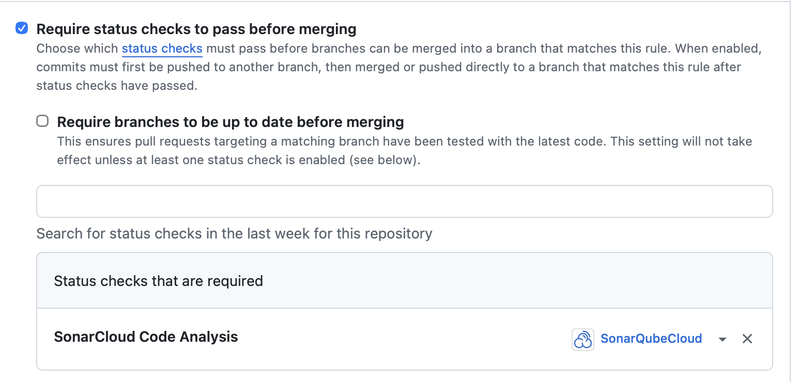
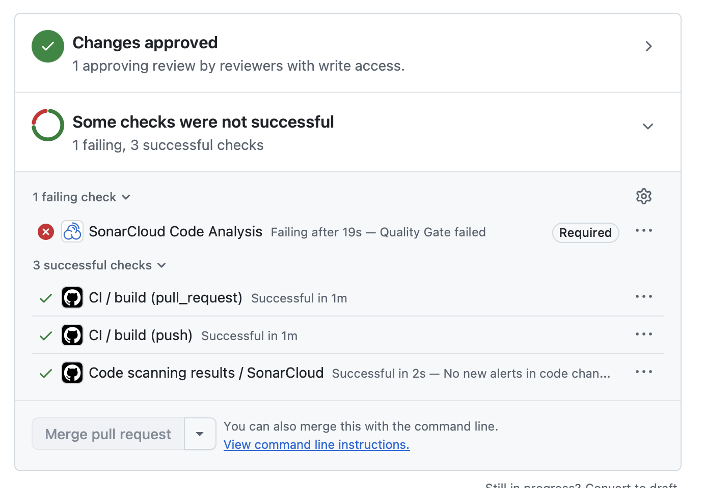
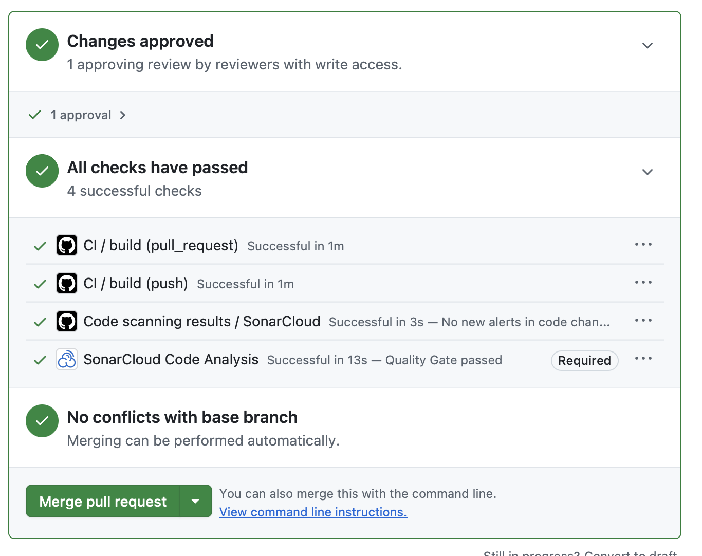

# Звіт SonarQube Cloud

## Проєкт
- Гілка: `main`
- Останній аналіз: `28 Oct 2026, 21:20`
- Статус: `Passed`

## Основні метрики

| Metric | Result |
| --- | --- |
| Code Smells | 10 |
| Maintainability Rating | A |
| Technical Debt | 0h |
| Duplicated Lines (%) | 0.0% |
| Reliability Rating | C |
| Security Rating | C |

## Підсумок

Аналіз проєкту в SonarQube Cloud пройшов успішно на останньому коміті гілки `main`. 
За результатами перевірки проект демонструє хорошу підтримуваність: 
рейтинг підтримуваності `A`, технічний борг відсутній (`0h`), 
а дублікація коду становить `0.0%`. Разом з тим, у проєкті зафіксовано `10` code smells, а оцінки за надійність 
та безпеку становлять `C`, що вказує на наявність ризиків, які необхідно усунути 
у подальших випусках.

## Детальний аналіз виявлених проблем

### 1) .github/workflows/ci.yml

Цей workflow містить кілька критичних попереджень щодо безпеки, 
які пов’язані з установкою залежностей без фіксації точних версій і без обмеження виконання setup scripts.

Основні проблеми:
- У секціях встановлення залежностей використовується установка без зафіксованих версій пакетів.
- Параметр `--only-binary :all:` не використовується, що може призвести до виконання setup scripts під час встановлення пакетів.
- Такі ризики є особливо важливими в CI/CD середовищі, адже вони можуть дозволити виконання невідомого або небезпечного коду під час збірки.
- SonarQube зафіксував три аналогічні попередження в рядках `L43`, `L45` і `L61`:
  - `Using dependencies without locking resolved versions is security-sensitive.`
  - `Omitting "--only-binary :all:" can lead to the execution of setup scripts. Make sure it is safe here.`

Суть проблеми:
- Без фіксації версій `pip`/`pip-tools` може завантажуватися більш нова версія пакета, ніж та, яка була перевірена в проєкті.
- Це збільшує ризик виникнення вразливостей, несумісності або небажаних змін у залежностях.
- Відсутність `--only-binary :all:` збільшує ризик виконання сценаріїв встановлення,
- особливо якщо пакунки з вразливими або підозрілими джерелами будуть завантажені під час CI.

Необхідно:
- Зафіксувати версії усіх зовнішніх залежностей через `requirements.txt`, `poetry.lock`, `pip-tools`, або `uv lock`.
- Якщо це можливо, використовувати безпечні інсталяційні механізми з хешами (`pip install --require-hashes`)
  або управління залежностями через lock-файли.
- Обмежити виконання setup scripts, де це необхідно, і перевіряти джерела пакетів.
- Розглянути використання `--only-binary :all:` лише в тих сценаріях, де це безпечно і не обмежує коректну роботу проєкту.

### 2) .github/workflows/deploy-api-docs.yml

У цьому workflow також зафіксовано подібне попередження безпеки:
- `Omitting "--only-binary :all:" can lead to the execution of setup scripts. Make sure it is safe here.`

Це означає, що в процесі розгортання документації також відбувається установка залежностей без 
розумного захисту від небезпечного виконання коду. Хоча це не є критичною помилкою в момент виконання, 
але для проектів із CI/CD та публічним розгортанням це є серйозним питанням безпеки.

Необхідно:
- Узгодити параметри встановлення залежностей між всіма workflow.
- Перевірити, чи є усі пакети завантажені з довірених джерел.
- Зафіксувати версії і забезпечити повторюваність збірок.

### 3) docs/api/index.html

У файлі документації `docs/api/index.html` виявлено попередження безпеки щодо підключення зовнішнього скрипта:
- `Add integrity and crossorigin="anonymous" attributes to this element to enforce integrity checks.`

Це означає, що зовнішній ресурс (наприклад, JS-скрипт або бібліотека) підключений без перевірки цілісності та 
без атрибутів `crossorigin="anonymous"`. Такий підхід може збільшити ризик підміни вмісту або підключення 
зловмисного ресурсу під час розгортання документації.

Необхідно:
- Додати атрибути `integrity` і `crossorigin="anonymous"` для всіх зовнішніх ресурсів.
- Використовувати підписані або перевірені URL-ресурси.
- Уникайте використання сторонніх файлів без перевірки їхнього хешу.

### 4) loadtests/locustfile.py

У цьому файлі SonarQube зафіксував проблему типу Reliability:
- `Remove this use of the output from "print"; "print" doesn’t return anything.`

Це означає, що в коді результат виклику `print()` використовується як якщо б він повертав значення, 
хоча в Python `print()` завжди повертає `None`. Подібні помилки можуть призвести до логічної плутанини 
в сценаріях тестування навантаження, особливо коли результат виклику використовується далі в умовах або при обробці даних.

Суть проблеми:
- Такі помилки знижують читабельність коду та можуть маскувати справжні проблеми в логіці.
- У сценаріях навантаження та автоматизованого тестування неправильне використання результатів функцій
  може ускладнити відлагодження і зменшити надійність тестів.

Необхідно:
- Не використовувати результат виклику `print()` як значення для подальшої логіки.
- Якщо потрібен лог або повернення значення, використовувати явне повернення з функції або зберігати дані в змінній.
- У сценаріях Load Testing слід чітко відокремлювати логування від обчислення даних.

## Висновок

На момент аналізу 28 жовтня SonarCloud зафіксував наведені вище проблеми
безпеки та надійності. Це історичний опис стану до виправлень на практичній,
а не перелік поточних прогалин. За наданими актуальними скриншотами SonarCloud
знахідок зараз немає; зріз метрик наведено в розділі «Лабораторна 8».

На той момент для покращення якості та безпеки рекомендувалося:
- закріпити версії залежностей,
- використовувати lock-файли,
- додати захист у CI/CD workflow,
- підключати зовнішні ресурси через `integrity` + `crossorigin="anonymous"`,
- виправити логічну помилку в `loadtests/locustfile.py`.

## Лабораторна 8

### Обрані метрики «до/після»

Звіт вище з метриками від 28 жовтня — стан до виправлень, виконаних на
практичній. Надані скриншоти SonarCloud показують поточний стан після цих
виправлень на `main` (`fb5c167`), але до трьох рефакторингів Лабораторної 8.
Тому вони є базою «до» для Лабораторної 8. Стовпець «після» треба заповнити
новим аналізом після злиття всіх трьох PR.

| Metric | До виправлень практичної (28.10) | До рефакторингів Лаб 8 (`fb5c167`)|
| --- | --- | --- |
| Code Smells | 10 | 0 |
| Reliability Rating | C | A |
| Technical Debt (minutes) | 0 | 0 |

На поточних скриншотах також видно Quality Gate `Passed`, `Issues` 0,
Maintainability `A` з 0 issues та Duplications `0.0%`. Technical Debt окремо
не показаний на скриншоті; значення `0` хвилин відповідає відсутності
Maintainability issues і має бути підтверджено на відповідній метриці
SonarCloud.

Коміт `b0208f7` (звіт до виправлень PR #214) позначено тегом
`lab8-baseline`. Поточний `main` після PR #214 — `fb5c167`.

### Security Rating і зв'язок з попередніми лабораторними

| Метрика | До виправлень практичної | Після виправлень практичної, до рефакторингів Лаб 8 |
| --- | --- | --- |
| Security Rating | C | A |
| Security issues | 10 ([до](./screenshots/before-28oct.png)) | 0 ([після](./screenshots/after-30oct.png)) |
| Reliability Rating | C | A |
| Reliability issues | 1 ([до](./screenshots/before-28oct.png)) | 0 ([після](./screenshots/after-30oct.png)) |

Знімок [до виправлень](./screenshots/before-28oct.png) показує на графіку
SonarCloud на **Oct 28, 2026 at 11:59 AM**: 10 Security issues і 1
Reliability issue. Знімок [після виправлень](./screenshots/after-30oct.png)
показує на **Oct 30, 2026 at 2:14 PM**: 0 Security issues і 0 Reliability
issues. Час наведено так, як його показує SonarCloud; часовий пояс у підказці
не вказаний. В історичному звіті від 28 жовтня рейтинги були Security `C` і
Reliability `C`; актуальна панель SonarCloud показує для обох `A`. Отже,
підтверджений перехід після виправлень практичної — `C → A`, а не результат
рефакторингів Лабораторної 8. Самі знімки Activity підтверджують точні лічильники
та час; рейтинг `A` підтверджується поточною панеллю проєкту.

Нуль знахідок SonarCloud не означає відсутності всіх можливих загроз: модель
загроз і ручна перевірка контролю доступу залишаються важливими. Рефакторинг
`resolve_request` не змінює поведінку авторизації або обробку винятків, тому
не слід приписувати йому покращення Security чи Reliability Rating.

Рефакторинг стосується загрози R2 — підвищення привілеїв через зміну ролі,
описаної у [моделі загроз Лабораторної 3](../architecture/threat-model.md):
спільна функція зберігає перевірку, що роль можна підвищити лише з `GUEST`.
Це також доповнює аналіз Лабораторної 5
([статичний аналіз і безпека](../code-quality/static-analysis.md)), де
пояснено, що логічні помилки контролю доступу можуть потребувати ручного
аналізу, а не лише Bandit.

### Рефакторинг Ольги Марущенко

Запах знайдено ручним аналізом, а не на панеліSonarCloud: це дублювання бізнес-правила в двох адаптерах,
а не скопійований текст, тому детектор дублювання SonarCloud його не фіксує (Duplications 0.0% до і після).

Техніка **Extract Function**: правило визначення ролі для схваленого запиту та
перевірку, чи потрібне підвищення ролі, винесено в
`role_for_approved_access_request` у `src/iam/models.py`. In-memory і
PostgreSQL адаптери використовують спільне правило. Збережено типи винятків,
повернений `AccessRequest` і SQL-запити.

Перевірки локально з увімкненою тестовою PostgreSQL-БД:
`tests/iam/test_access.py`, `tests/iam/test_postgres_adapters.py` і
`tests/api/test_access_requests_api.py` — 52 passed.

### Рефакторинг Ольги Бідочки

Техніка **Replace Magic Number with Constant**: значення тайм-ауту відкриття
пулу (`10` секунд) і стандартні розміри пулу (`min_size=1`, `max_size=10`)
винесено в `POOL_OPEN_TIMEOUT_S`, `DEFAULT_POOL_MIN` і `DEFAULT_POOL_MAX` у
`src/db/connection.py`. Значення за замовчуванням і поведінка відкриття пулу
не змінилися. Характеризаційні тести з окремого
[PR #233](https://github.com/ukma-fin-ssdm-2026/noproblem/pull/233)
залишаються зеленими після рефакторингу: `tests/db/test_connection.py` — 5
passed.

### Рефакторинг Анастасії Козинської

**Запах:** довгий ланцюжок умов у `document_error_detail`
(`src/api/documents.py`). Шість послідовних `if isinstance(...)` повертали
пару «HTTP-статус, текст помилки», тож кожен новий виняток означав ще одну
гілку в функції.

**Техніка:** **Replace Conditional with Map**. Відповідність «клас винятку →
статус → шаблон тексту» винесено в таблицю `DOCUMENT_ERROR_RESPONSES` на рівні
модуля. Функція проходить таблицею через `isinstance` і підставляє в шаблон
поля винятку (`document_id`, `paragraph_id`). Тіло функції скоротилося з 33
рядків до 4. За правилами Cognitive Complexity від SonarSource складність
функції зменшилась з 6 (шість `if`) до 3 (цикл і вкладений `if`). На панелі
SonarCloud метрики не змінилися: Code Smells і Technical Debt уже були 0.

**Що лишилося незмінним:**
- HTTP-статуси (404, 409, 422) і тексти помилок, символ у символ;
- порядок перевірок і перевірка через `isinstance`: підкласи
  `InsertPositionError` і `MovePositionError` обробляються як раніше;
- виняток без запису (зокрема базовий `ParagraphPositionError`) так само
  передається далі й стає 500;
- сигнатура функції та обробник `register_document_error_handlers`.

**Що змінилося в структурі:** дані (статуси й тексти) відокремлено від
логіки вибору. Новий виняток тепер додається одним рядком таблиці, а не
новою гілкою `if`.

**Тести-докази:** `tests/api/test_documents_api.py`,
`tests/api/test_documents_boundaries.py`, `tests/api/test_paragraphs.py`,
`tests/api/test_document_lifecycle.py`. Вони перевіряють коди й тексти
відповідей для всіх шести винятків через HTTP.

| Перевірка | До рефакторингу | Після рефакторингу |
| --- | --- | --- |
| `pytest tests/api -q` | 135 passed in 3.05s | 135 passed in 3.14s |
| `black --check src/api/documents.py` | — | без змін |
| `flake8 src/api/documents.py` | — | 0 зауважень |

### Регресійне тестування на main

Для порівняння виконано повний набір тестів з покриттям на стані `main`
перед рефакторингами Лабораторної 8 (`fb5c167`) і на актуальному `main`
після злиття PR #232, #233, #234 і #241 (`25e6ed1`). В обох випадках
використано однакову команду з CI:
`python -m pytest --cov --cov-report=term-missing -q`.

| Результат | До (`fb5c167`) | Після (`25e6ed1`) |
| --- | ---: | ---: |
| Пройшло тестів | 394 | 399 |
| Помилки / пропуски тестів | 0 / 0 | 0 / 0 |
| Загальне покриття коду | 95.86% | 95.85% |
| Поріг CI | 90% — досягнуто | 90% — досягнуто |

Різниця у п'ять тестів відповідає новим характеризаційним тестам
`tests/db/test_connection.py`, доданим до базового стану в PR #233.

### Використання ШІ

**Який рефакторинг:** `document_error_detail` (Replace Conditional with Map),
описаний вище.

**Агент:** Claude (застосунок Claude з доступом до файлів репозиторію).

**Завдання агенту** містило запах (ланцюжок із шести `if isinstance`),
техніку (Replace Conditional with Map) і те, що має лишитися незмінним:
статуси й тексти символ у символ, перевірка через `isinstance` (а не
`type(exc)`, бо в ієрархії є підкласи), `raise exc` для винятку без запису,
сигнатура функції; обмеження — лише `src/api/documents.py`, рядок до 79
символів.

**Що згенеровано:** таблиця `DOCUMENT_ERROR_RESPONSES` з шаблонами тексту
(`str.format_map` з атрибутів винятку) і нове тіло функції з циклом.
Варіант із `lambda` для кожного тексту агент відкинув, бо довгі рядки
перевищували б ліміт 79 символів, а для сталих текстів `lambda` зайва.

**Як верифіковано:**
1. Перегляд диффу рядок за рядком: порядок записів, тексти, `raise exc`.
2. Порівняння старої й нової функції на всіх шести винятках і на
   `ParagraphPositionError` та `DocumentsError`: однакові статуси й тексти,
   однаково викинутий виняток.
3. `black --check` і `flake8` без зауважень.
4. Регресійні тести: 135 passed до і 135 passed після.
5. Quality Gate SonarCloud на PR з рефакторингом.

## Бонуси

### Quality Gate як обов'язкова перевірка PR

Для гілки `main` увімкнено правило захисту: злиття лише через PR, обов'язкова
перевірка **SonarCloud Code Analysis** і одне схвалення. Обхід правила
заборонено й адміністраторам.

Щоб показати роботу перевірки, у тестовому PR навмисно продубльовано метод
`search` у `src/search/service.py`. CI (black, flake8, bandit, pytest) був
зеленим, а Quality Gate упав через дублювання в новому коді. PR мав
схвалення, але влити його не можна було саме через червону обов'язкову
перевірку SonarCloud.

Після видалення дубля в тій самій гілці Quality Gate став зеленим, і злиття
стало доступним. PR закрито без злиття, бо код був лише демонстрацією.

- PR, який перевірка зупинила:
  [PR #240](https://github.com/ukma-fin-ssdm-2026/noproblem/pull/240)
- Прогін з червоним статусом (Quality Gate failed): коміт
  [`8808c9e`](https://github.com/ukma-fin-ssdm-2026/noproblem/pull/240/changes/8808c9ed6737f614eba22b3880c690ab291faef4)
  з навмисним дублюванням
- Прогін з зеленим статусом після виправлення (Quality Gate passed): коміт
  [`deffc1c`](https://github.com/ukma-fin-ssdm-2026/noproblem/pull/240/changes/deffc1ca43010459c53d6b387a1189c0ef5ddbc4)
  з видаленим дублем

### Характеризаційні тести перед рефакторингом

Модуль `src/db/connection.py` до Лабораторної 8 не мав тестів. Спершу в
[PR #233](https://github.com/ukma-fin-ssdm-2026/noproblem/pull/233) додано
`tests/db/test_connection.py` (коміт `83b6262`), що фіксує поточну поведінку
модуля. Лише після цього в
[PR #234](https://github.com/ukma-fin-ssdm-2026/noproblem/pull/234) виконано
рефакторинг Replace Magic Number with Constant (коміт `7f72cb8`). Ті самі
5 тестів зелені до і після рефакторингу.

- database_url() повертає None, якщо DATABASE_URL порожня або містить лише пробіли, табуляцію чи перенесення рядка.
- load_env_file() завантажує значення з .env, але не перезаписує змінну, яка вже задана в оточенні.
- create_pool(..., open_immediately=False) створює пул, не відкриваючи з’єднання, зі стандартними розмірами min_size=1 і max_size=10.
Параметризований тест для database_url() перевіряє три варіанти порожнього значення; разом файл містить 5 тестових випадків. Вони зафіксували очікувану поведінку, яку потрібно було зберегти під час рефакторингу.
